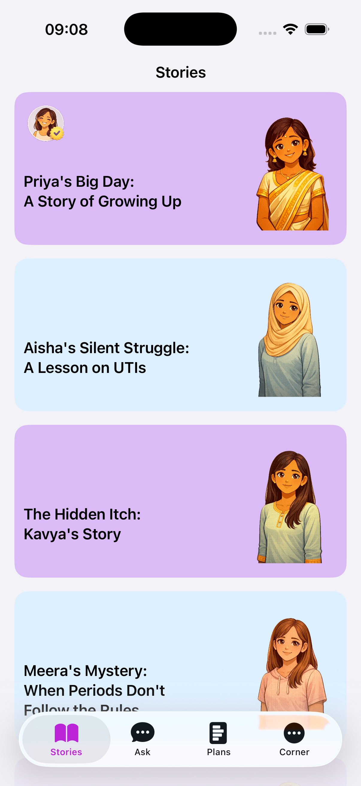
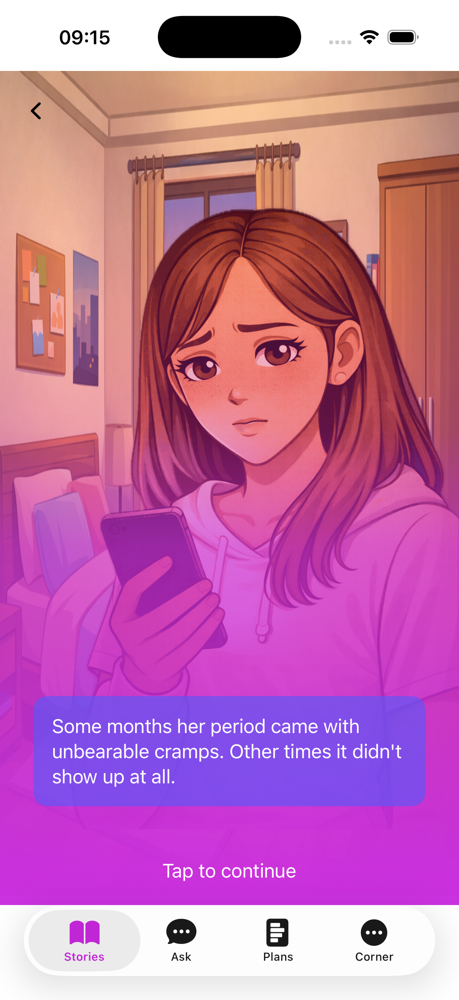
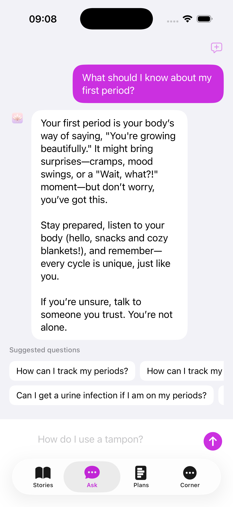

## Vaani

Vaani is an iOS application designed to help teens and young adults understand their bodies, periods, and reproductive health through **interactive stories**, a **Q&A chat**, and **personalized plans**.

### Screenshots

Stories list:

Story detail:

Ask Vaani:

### Features

- **Stories**: Narrative journeys like *Priya's Big Day* and *Aisha's Silent Struggle* that explain health topics in a friendly, relatable way.
- **Ask**: A chat-style interface where users can ask questions such as “What should I know about my first period?” and get clear, supportive answers.
- **Plans & Corner**: Spaces for tracking, learning, and reflecting on health habits and experiences.

### Tech stack

- **Platform**: iOS
- **Language**: Swift / SwiftUI
- **Project type**: Swift Package app (`Package.swift` with `iOSApplication` product)

### Getting started

1. Open the project in Xcode 16 or later.
2. Select the `Vaani` iOS app scheme.
3. Build and run on an iOS 17+ simulator or device.

